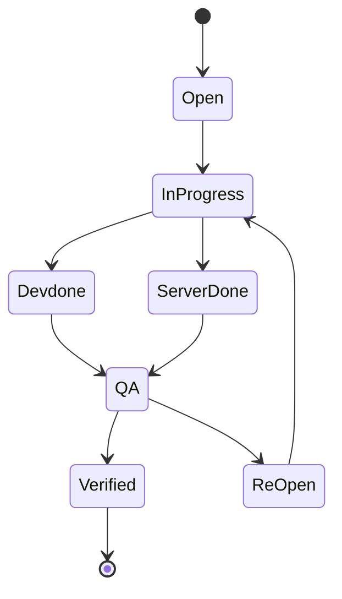

<p align="center">
  <a href="https://github.com/iambilalshahid/qa-sheet-mcp"></a>
  <a href="./LICENSE"></a>
  <a href="https://github.com/iambilalshahid/qa-sheet-mcp"></a>
</p>

<p align="center">
  
  
  
  
  
  
</p>

<p align="center">
  <b>Your QA bugs live in Google Sheets. AI actually SEES the screenshot, fixes the code, and marks it Devdone.</b><br/>
  No CSV export. No copy-paste. No tab switching. Just MCP magic.
</p>

---

## 😤 The Problem Every Dev Team Has

Your QA team logs bugs in Google Sheets. Smart. Organized. Totally fine.

Then the dev gets pinged.

**Here's what actually happens next:**

1. Open the sheet *(Tab 1)*
2. Find your assigned bug *(scroll, scroll, find the row)*
3. See a Snipboard screenshot link — click it *(Tab 2)*
4. Look at the image. Describe it mentally.
5. Switch back to your code *(Tab 3 — or VSCode — or wherever)*
6. Try to fix something you're now half-remembering
7. Go back to the sheet *(Tab 1, again)*
8. Manually type `Devdone` — or mis-type `DevDone` and break the dropdown

**That's 6+ context switches. Per bug. Every single time.**

20 bugs a day? You just spent your morning on tab gymnastics.

And the worst part? **Your AI assistant never saw the screenshot.** You're out here describing UI bugs in plain text like it's 2019.

---

## 💡 There Is a Better Way

**buglens** is an MCP server that plugs directly into your editor and closes the entire loop — automatically.

> Pull the bug → AI sees the screenshot → Fix the code → Devdone auto → Done ✅

Your AI reads the sheet **live** (not a CSV export — *live*), fetches the Snipboard link, **actually sees the visual bug**, fixes your code, and marks it `Devdone`. You never left your editor. You never opened a tab. You never typed a status.

---

## 🎯 How It Works

| Step | What Happens | Under the Hood |
| --- | --- | --- |
| 1. Live Sheet | AI pulls your open bugs by assignee | `gspread` live API — no CSV, always fresh |
| 2. Vision | AI fetches the Snipboard link and **SEES** the screenshot | `get_bug_screenshot()` → base64 → Gemini Vision |
| 3. Fix | AI understands the visual bug and patches the code | Certificates, Dashboard, Student modules |
| 4. Devdone | AI writes status back to the exact row | `mark_as_devdone()` — case-safe, no dropdown breaks |

---

## 🌳 Project Structure

<details>
<summary><b>📦 qa-sheet-mcp</b></summary>
<blockquote>

<details>
<summary><b>📁 src</b></summary>
<blockquote>

<details>
<summary><b>📁 qa_sheet_mcp</b></summary>
<blockquote>

*   📄 `__init__.py`
*   📄 `server.py` — *Main MCP server containing 8 registered tools*
</blockquote>
</details>

</blockquote>
</details>

<details>
<summary><b>📁 AGENTS</b></summary>
<blockquote>

*   📄 `GEMINI.md` — *Gemini agent specific configurations*
*   📄 `CLAUDE.md` — *Claude agent specific configurations*
*   📄 `AGENTS.md` — *General cross-agent context metrics*
*   📄 `VIBE.md` — *Guidelines for autonomous vibe coding sessions*
*   📄 `DEV.md` — *Developer workspace log book*
</blockquote>
</details>

*   📜 `pyproject.toml` — *Project metadata and package dependencies*
*   🚫 `.gitignore` — *Ignore specs for builds, credentials, and virtual envs*
*   📖 `README.md` — *This roadmap documentation*

</blockquote>
---

## Installation

# 1. Create venv
python3 -m venv venv
source venv/bin/activate
# 2. Install from GitHub
pip install git+https://github.com/iambilalshahid/buglens.git
# 3. Or for local dev
git clone https://github.com/iambilalshahid/buglens.git
cd buglens
pip install -e .
```

[Jump to Gemini Installation](./AGENTS/GEMINI.md)

</details>

<details>
<summary><b>Clone for local dev / contribution</b></summary>

```bash
git clone https://github.com/iambilalshahid/qa-sheet-mcp.git
cd qa-sheet-mcp
python3 -m venv venv
source venv/bin/activate
pip install -e .
```

</details>

---

## ⚙️ Configuration

Add this block to your `mcp.json` — works with **Cursor**, **Claude Desktop**, and **Antigravity**.

```json
{
  "mcpServers": {
    "qa-sheet": {
      "command": "python",
      "args": ["-m", "qa_sheet_mcp.server"],
      "env": {
        "SHEET_ID": "your-sheet-id-here",
        "WORKSHEET_NAME": "Admin bug report",
        "GOOGLE_CREDS_PATH": "./credentials.json",
        "QA_ASSIGN_TO": "Bilal",
        "QA_PROBLEM_TYPE": "FE"
      }
    }
  }
}
```

<details>
<summary><b>🔑 Environment variable reference</b></summary>

| Variable | Description |
| --- | --- |
| `SHEET_ID` | From URL `/d/<THIS>/edit` — use `l` not `I` (easy to confuse) |
| `WORKSHEET_NAME` | Your sheet tab name — e.g. `Admin bug report` |
| `GOOGLE_CREDS_PATH` | Path to your Service Account `credentials.json` |
| `QA_ASSIGN_TO` | Your name exactly as it appears in the sheet: `Bilal`, `Ahmar` |
| `QA_PROBLEM_TYPE` | Filter by type: `FE`, `BE`, or `FE,BE` |

</details>

---

## 🔄 Status Workflow

Every transition is validated. No more typos silently breaking your dropdown.



**Valid values:** `Open` · `In-Progress` · `Devdone` · `QA` · `Re-Open` · `Verified` · `Discussion` · `Hold` · `Server Done`

---

## 🛠️ The 7 Tools

| Tool | What it does |
| --- | --- |
| `get_frontend_bugs_online` | Pull your open FE bugs live from the sheet (with `row_number`) |
| `get_bug_screenshot` | Fetch Snipboard URL → base64 → AI sees the bug visually |
| `mark_as_inprogress` | Flip status: `Open` → `In-Progress` |
| `mark_as_devdone` | Flip status: → `Devdone` (case-safe write) |
| `get_status_list` | Valid dropdown values + full workflow reference |
| `get_fix_history` | What you fixed today — reads from `~/` history |
| `debug_sheet_info` | Sheet debug info when things go sideways |
---

## 🤝 Contribute

Open source, solo-built, PRs welcome — especially for:

- New tool ideas (comment on a bug row? bulk update?)
- More integrations: Notion, Jira, Linear
- Better vision prompting strategies

```bash
git clone https://github.com/iambilalshahid/qa-sheet-mcp.git
git checkout -b feature/your-idea
git commit -m "Add: your feature"
git push origin feature/your-idea
# → Open a Pull Request
```

---

## 👤 Author

**Bilal Shahid** — Solo Dev
GitHub: [@iambilalshahid](https://github.com/iambilalshahid)

---


<p align="center">MIT © Bilal Shahid • Open Source • FastMCP</p># buglens
